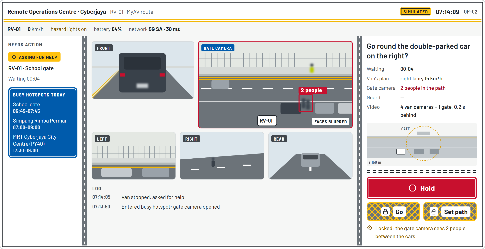

# MATA KEDUA

A second pair of eyes for Cyberjaya's driverless vans. Team Bob, Asia Pacific University, for the Cyberjaya 5G Future Talent Innovation Challenge 2026 (Track 2: 5G Connected & Safe Last-Mile Mobility).

**Try the interactive prototype: https://zghanw.github.io/matakedua/**

Since 20 October 2026, a fully driverless delivery van has been on trial on Cyberjaya's roads. Vans like it stop and ask a remote operator for help when they are unsure, and the operator sees only the van's own cameras. MATA KEDUA gives that operator a second view: at busy spots such as a school gate at drop-off, a roadside camera's view opens over 5G, and Go stays locked while that view shows people in the path. The operator never steers; the van checks every path.

## Documents

| Document | What it covers |
|---|---|
| [Slide deck](MATAKEDUA-Track2.pdf) | The 18-slide entry |
| [Research report](MATAKEDUA-research-report.pdf) | A desk-based design study, with full references |
| [Proposal](MATAKEDUA-proposal.pdf) | Objectives, phases, budget, partners and risks |

## About the prototype

A simulated run of one assist plays on its own; click anything to take over. It is in English, with a Bahasa Melayu toggle. All data are simulated and the camera views are drawings. It is not a real emergency service: in an emergency in Malaysia, call 999, or 112 from a mobile phone.

Team: Chan Hao Wen (Team Leader), Wong Jia Hern, Lim Hong Yu.

For developers: `index.html` is the whole prototype, one file with no build step; `#step2` to `#step11` open a step directly.
